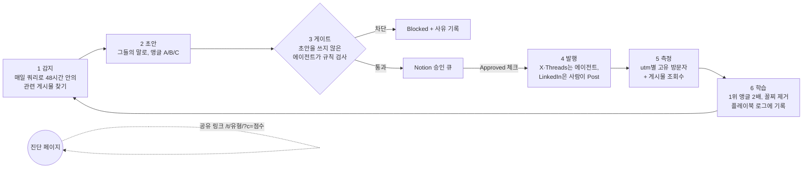

# AI 사일로 진단 · 에이전트 GTM 루프

> **해커톤 과제:** 실제 사람에게, 확장 가능하게, 최대한 많이 닿는 에이전트 GTM 루프를 만든다. 루프는 만든 뒤 7일 동안 돌고, **봇을 뺀 도달 인원**으로 평가한다.

**라이브 페이지:** https://ai-silo-check.vercel.app

## 핵심 아이디어

제품(사람과 AI 에이전트가 같은 맥락에서 일하는 업무 공간)은 아직 없다. 그래서 **제품보다 제품이 푸는 문제를 먼저 배포한다.**

배포하는 것은 1분짜리 "AI 사일로 진단" 페이지다. 루프는 매일 이 진단을 들고 고객이 이미 모여 있는 곳으로 간다. 진단 결과는 공유 링크를 타고 팀 단톡방으로 퍼진다.

마케팅 과정 자체가 제품 주장의 시연이기도 하다. 에이전트와 사람이 하나의 맥락(Notion 큐와 플레이북)을 공유하며 일한다.

## 왜 이렇게 설계했나

| 조건 | 설계 결정 |
|---|---|
| 점수 = 봇을 뺀 도달 인원 | 모든 링크를 **추적 페이지 하나**로 모은다. 링크마다 `utm` 태그를 붙이고, 고유 방문자는 Vercel Web Analytics로 센다. 게시물 조회수는 별도로 기록한다. |
| 제품이 없다 | 약속할 수 있는 것은 "상태 확인"뿐이다. 그래서 진단 자체가 가치를 준다(결과 유형과 바로 해 볼 개선 3가지). 페이지는 제품을 "만들고 있습니다"라고만 말한다. |
| 콜드 스타트: 연락처 리스트도, 숙성된 발송 도메인도 없다 | 콜드 이메일과 대량 DM 대신 공개 게시물, 답글, 공유로 간다. 새 도메인은 예열에 몇 주가 걸리고, 한국은 광고성 메시지에 사전 동의가 필요하다(정보통신망법 제50조, 1차 출처 미확인). |
| 1:1 채널에는 상한이 있다 | 크게 닿는 도달은 **남의 청중**(크리에이터, 커뮤니티)과 **공유 루프**(챌린지 링크)에서 나온다. |

## 중간 목표

| 단계 | 언제 | 무엇이 참이 되면 달성인가 |
|---|---|---|
| M1 | 오늘 | 루프 1회전(감지 → 초안 → 게이트 → 승인 큐)이 끝까지 돈다. 심어 둔 불량 초안을 게이트가 막는다. ✅ |
| M2 | D1–D2 | 채널별로 앵글 A/B/C 가운데 방문자를 가장 많이 데려온 앵글이 가려진다. |
| M3 | D3–D7 | 공유 경유 방문(`utm_source=share`)이 전체의 30% 이상이 되어 자력 확산이 시작된다. *기준값은 판단이며 검증된 수치가 아니다.* |

## 루프 구조

| 단계 | 하는 일 | 파일 |
|---|---|---|
| 감지·초안·게이트 | 매일 아침 실행 | [`loop/runs/01-sense-draft.md`](loop/runs/01-sense-draft.md) |
| 발행 | 점심·저녁 실행 | [`loop/runs/02-publish.md`](loop/runs/02-publish.md) |
| 측정·학습 | 밤 실행 | [`loop/runs/03-measure-learn.md`](loop/runs/03-measure-learn.md) |
| 규칙(게이트), 앵글, 링크 태그 | 루프가 매번 읽는 기준 | [`loop/playbook.md`](loop/playbook.md) |
| 일정 | 예약 작업 정의 | [`loop/schedule.md`](loop/schedule.md) |

## 누구에게, 어디서, 무엇을

| ID | 누구 | 그들이 쓰는 말 ([출처](research/pain-language.md)) | 채널 | 앵글 |
|---|---|---|---|---|
| A | 5–50인 회사의 실무자와 팀 리드 | "카톡으로 보고 다 했어요" | Threads(주력), X | "어제 정한 일, 단톡방 몇 번 올려서 찾았어요?" |
| B | 일에 AI를 쓰는 사람들(대형 AI 크리에이터의 청중) | "각자의 AI 활용법을 조용히 숨기고 있다" | Threads 답글, X | "팀원 5명이 ChatGPT를 각자 쓰면 회사 맥락도 5군데에 쌓인다" |
| C | 대표와 운영 책임자 | "일단 구독부터 결제합니다. 한 달 뒤, 업무는 조금도 달라지지 않습니다." | LinkedIn | 관찰형 글 + "점수 댓글로 남겨 주세요" |

## 익숙한 채널 밖의 실험

| 실험 | 상태 | 왜 효과가 클 수 있나 |
|---|---|---|
| **챌린지 링크** ([설명](plays/challenge-link.md)) | 구현, 배포 | 한국에서 검증된 바이럴 형식(유형 테스트)이다. 결과 유형은 4개다: 단톡방 고고학자형, AI 각개전투형, 한 사람 브레인형, 연결된 팀. 공유 링크는 보낸 사람의 점수와 유형을 싣고 가서 받는 사람에게 "팀원은 9점, AI 각개전투형. 당신은?"이라고 묻는다. 링크 미리보기 이미지도 유형마다 다르다. 같은 팀 안의 점수 차이가 곧 사일로라는 메시지가 공유 행위 자체에서 드러난다. |
| **에이전트가 스스로를 마케팅하는 일주일** ([초안](plays/build-in-public.md)) | 초안 | 루프 자체를 GeekNews와 Disquiet에 공개하고 매일 숫자를 업데이트한다. "에이전트와 사람이 같은 맥락에서 일한다"는 제품 주장을 GTM 과정이 직접 보여 준다. |
| **크리에이터 청중 빌리기** ([초안](plays/creator-seeding.md)) | 초안, 건별 승인 | 진단을 무료 콘텐츠로 제안한다. 팔로워 1만–13만 계정의 리포스트 한 번이 우리 게시물 일주일치를 넘을 수 있다. |
| 라이브 데이터 리포트 | 보류 | 응답 저장소가 필요하고, "응답을 저장하지 않는다"는 약속과 충돌해 보류했다. |

## 검증: 우리 말고 무엇이 맞다고 말해 주나

- **게이트 테스트** ([결과](tests/gate-cases.md)):
  - 심어 둔 불량 초안(가짜 "고객사 300곳·40%", 압박 문구, 계정 태그)을 독립 에이전트가 **차단**했다.
  - 정상 초안 3건은 통과했다.
  - 오탐 1건이 나왔다. 원인은 플레이북에 인용 출처가 빠진 것이었고, 출처를 넣어 고쳤다.
- **페이지 E2E** ([`tests/page-e2e.js`](tests/page-e2e.js)): 헤드리스 브라우저로 챌린지 흐름을 클릭해 확인했다. 배너, 유형, 점수 비교, 공유 링크가 맞게 나오고 JS 오류는 0건이다.
- **실제 심판:** 고유 방문자(Vercel Web Analytics), 플랫폼 조회수, 공유 경유 방문 비율.

## 실행 방법

1. **페이지:** Vercel에 `site/`를 배포한다. Build는 `npm run build`, Output은 `public`이다. 프로젝트에서 Web Analytics를 켠다.
2. **Notion:** [`loop/notion-schema.sql`](loop/notion-schema.sql) 대로 Post Queue를 만들고, 플레이북 페이지를 둔다.
3. **예약 작업 3개:** [`loop/schedule.md`](loop/schedule.md)대로 등록한다. Claude in Chrome이 X와 Threads에 로그인된 상태여야 한다.
4. **사람이 하는 일:** 하루 한 번 Notion에서 Approved를 체크한다(약 5분). LinkedIn은 직접 Post를 누른다.

## 비용

| 항목 | 내용 |
|---|---|
| 돈 | $0. Vercel Hobby와 Notion, 기존 Claude 구독을 쓴다. |
| 에이전트 | 하루 3회 실행, 회당 약 10–20분(추정) |
| 사람 | 하루 약 5–10분(승인과 LinkedIn 게시) |

## 한계와 확인하지 않은 것

- 봇 제외는 일부만 확인했다.
  - 확인한 것: Vercel 분석 스크립트(`/_vercel/insights/script.js`) 원문에는 `navigator.webdriver`나 Headless 브라우저면 집계를 보내지 않는 코드가 있다.
  - 확인하지 못한 것: 서버 쪽에서 봇을 거르는지는 문서로 확인하지 못했다.
- 브라우저로 X와 Threads에 자동 게시하는 것은 플랫폼 약관에 걸릴 수 있다(미확인).
  - 하루 상한, 20분 간격, 사람 승인으로 위험을 줄였지만 계정 제재 가능성은 남아 있다.
- 정보통신망법 제50조 해석은 1차 출처로 확인하지 않았다.
- 크리에이터 팔로워 수는 2025-05 기준 2차 출처라 현재 수치는 확인하지 않았다.
- 고객 언어 연구는 블로그와 커뮤니티 위주다. Threads와 X 원문은 매일 아침 실행이 로그인된 브라우저로 직접 수집한다.
- Chrome이 켜진 PC가 꺼져 있으면 발행 실행은 건너뛴다. 큐는 남아 있으므로 다음 실행이 이어받는다.
