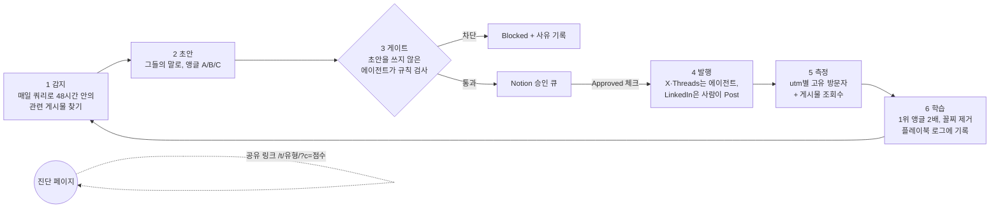

# AI 사일로 진단 · 에이전트 GTM 루프

> **해커톤 과제:** 실제 사람에게, 확장 가능하게, 최대한 많이 닿는 에이전트 GTM 루프를 만든다. 루프는 만든 뒤 7일 동안 돌고, **봇을 뺀 도달 인원**으로 평가한다.

**라이브 페이지:** https://ai-silo-check.vercel.app

## 7일 목표 (2026-10-31 토 18:00까지)

| 지표 | 목표 | 어떻게 재나 |
|---|---|---|
| 고유 방문자(봇 제외) | **5,000명** | Vercel Web Analytics. 집계 스크립트는 자동화 브라우저에서는 보내지 않는다. |
| 진단 완료 | **1,500명** (방문자의 30%) | `/result/{유형}` 경로의 방문자 |
| 공유로 들어온 비율 | **30%** | `/t/{유형}/` 경로의 방문자 ÷ 전체 방문자 |
| 게시물 조회수 | **100,000회** | 매일 밤 실행이 각 게시물에 표시된 조회수를 읽는다. 읽지 못하면 "미측정"으로 남긴다. |

**목표를 거꾸로 쪼개면:** 아래 비율은 모두 기준값이 없는 가정이다. 매일 밤 실제 값으로 바꿔 넣는다.

| 경로 | 계산 | 방문자 |
|---|---|---|
| 마케팅 | 조회수 100,000 × 클릭률 2% | 2,000명 |
| 커뮤니티 | 큰 게시 4회 × 회당 375명 | 1,500명 |
| 공유 | 위 두 경로로 온 3,500명이 데려오는 사람 | 1,500명 |
| **합계** | | **5,000명** |

- 공유 1,500명은 전체 5,000명의 30%다. 위 표의 공유 유입 비율 목표와 같은 숫자다.
- 진단 완료 1,500명은 방문자 5,000명 × 완료율 30%로 잡았다.

**왜 대담하게 잡았나:** 무난한 목표는 무난한 실행을 부른다. 이 목표는 "자체 계정에 꾸준히 올리기"만으로는 닿지 않는다. 커뮤니티 큰 게시 한 번과 공유 루프가 함께 터져야 닿는다. 그래서 루프가 그 둘에 시간을 몰아주도록 설계했다.

## 범위: 정해지지 않은 다수에게 닿는 GTM

이번 7일은 **불특정 다수에게 공개적으로 닿는 두 모션**만 루프로 돌린다.

| 모션 | 역할 | 이번 7일 |
|---|---|---|
| **마케팅** (자체 채널: Threads, X, LinkedIn) | 매일 반복해서 조회수를 쌓는다 | ✅ 루프로 실행 |
| **커뮤니티** (GeekNews, Disquiet, GPTers, 커리어리 등) | 한 번에 큰 유입을 만든다 | ✅ 루프로 실행 |
| 제품(진단 페이지와 챌린지 링크) | 두 모션이 데려온 사람을 완료와 공유로 바꾼다 | 공통 기반(작동 중) |
| 파트너십, 세일즈 | 특정 상대를 골라 1:1로 접근한다 | 이번 범위 밖 |

### 마케팅 플랜
| 채널 | 타깃 | 형식 | 하루 분량 |
|---|---|---|---|
| **Threads**(주력) | A 실무자·팀 리드, B 일에 AI를 쓰는 사람 | 질문형 게시물, 결과 유형 카드, 큰 AI 계정 글 아래 조언형 답글 | 게시물 3, 답글 5 |
| **X** | B | 짧은 관찰형 게시물, build in public 숫자 | 게시물 3, 답글 5 |
| **LinkedIn** | C 대표·운영 책임자 | 관찰형 글 + "점수 댓글로 남겨 주세요" | 게시물 1(사람이 Post) |
| **Instagram** | A, B | 결과 유형 4개를 카드뉴스(캐러셀)로: "당신 팀은 어느 유형?" | 게시물 1(사람이 게시) |
| **네이버 블로그** | 검색하는 사람 전체 | "업무 카톡방 정리", "인수인계 체크리스트", "팀 AI 도입" 같은 검색어를 겨냥한 글. 진단으로 연결한다. | 주 3편 |
| **브런치** | C 대표·운영 책임자 | 에세이 "AI를 샀는데 팀은 그대로인 이유" | 주 1편 |

- **Threads가 주력인 이유:** 팔로워가 아닌 사람에게도 추천 피드로 노출되는 구조라 콜드 스타트에 유리하다(판단). 한국 사용자가 많다는 점도 이유지만 미확인이다.
- **매일 숫자 공개:** 하루 1회 build in public 게시물로 "d{n} · 방문자 · 이긴 문장 · 게이트가 막은 것"을 올린다. 숫자 자체가 콘텐츠다.

### 커뮤니티 플랜
| 일차 | 장소 | 내용 |
|---|---|---|
| D1 | GeekNews (Show GN) | "에이전트가 일주일 동안 혼자 GTM을 돌리면 몇 명에게 닿을까": 루프 공개와 저장소 |
| D2 | Disquiet | 제품보다 문제를 먼저 배포한 이야기와 진단 |
| D3 | GPTers | 에이전트 GTM 루프 구조(게이트, 코드화한 규칙, 학습) 사례 공유 |
| D5 | 커리어리 | 중간 결과: 어떤 문장이 사람을 데려왔고 무엇이 막혔나 |
| D4 | 카카오톡 오픈채팅(AI 활용, 스타트업 운영 방) | 방 규칙이 허용하는 곳에 진단을 공유한다. 하루 1곳까지. |
| D6 | Product Hunt(영어) | 다음 시장(영어권)을 미리 시험한다. 진단의 영어판이 필요하다. |
| 상시 | 페이스북 그룹, 디스코드 AI 서버 | 홍보 게시판이 따로 있는 곳만 |
| D7 | GeekNews·Disquiet 후속 | 7일 결과 공개 |

**규칙:**
- 장소마다 홍보 규칙을 먼저 확인한다. 어긋나면 올리지 않는다.
- 만든 사람임을 밝힌다.
- 같은 글을 여러 곳에 복사하지 않는다.
- 하루 최대 1곳에 올리고, 달린 댓글에는 모두 답한다.
- 커뮤니티 게시는 에이전트가 초안과 작성 창을 준비하고 **사람이 직접 올린다**. 여론 조작(astroturfing)을 막기 위해서다.

**학습:** 매일 밤 측정·학습 실행이 마케팅과 커뮤니티의 "행동당 방문자"를 비교한다. 다음 날 시간 배분과 메시지 앵글을 함께 바꾼다.

## 이 루프의 새로운 점

1. **GTM 과정이 곧 제품 시연이다.** 제품의 주장은 "사람과 에이전트가 같은 맥락에서 일한다"이다. 이 루프도 에이전트와 사람이 하나의 맥락(플레이북, Notion 큐, 학습 로그)을 공유하며 돌아간다.
2. **페이지 자체가 배포 채널이다.** 공유 링크가 보낸 사람의 점수와 유형을 싣고 간다. 받는 사람은 "팀원은 9점, 당신은?"이라는 질문을 받는다. 같은 팀 안의 점수 차이가 곧 사일로라서, 공유하는 행위가 제품이 풀려는 문제를 보여 준다.
3. **거짓말과 스팸을 못 하게 만든 루프다.**
   - 초안을 쓰지 않은 에이전트가 게이트를 맡는다.
   - 상한, 게시 대상, 학습 규칙은 코드가 지킨다.
   - 그 코드는 안전장치를 하나씩 일부러 망가뜨려 40가지 모두를 잡아내는지로 검증했다.
   - 독립 검토자와 X 공식 코드, 인용 원문으로 외부 확인을 받았다.
4. **매일 스스로 고친다.** 밤마다 링크별 방문자를 재서 메시지 비중을 바꾼다. 무엇을 왜 바꿨는지 로그에 남긴다.

## 왜 제품이 아니라 문제부터 시작하나

1. **보여 줄 제품이 아직 없다.** 없는 기능을 약속하면 신뢰를 잃는다. 문제는 지금도 실제로 존재한다.
2. **불특정 다수는 카테고리를 검색하지 않는다.** "에이전트 업무 공간"을 찾는 사람은 드물다. 하지만 "단톡방에서 어제 정한 일 찾기"는 매일 겪는다. 낯선 사람에게 닿는 훅은 카테고리가 아니라 통증이다.
3. **진단이 지금 바로 가치를 준다.** 결과 유형과 바로 해 볼 개선 3가지를 준다. 그래서 제품 없이도 클릭하고 공유할 이유가 생기고, 도달과 완료를 지금부터 잴 수 있다.
4. **출시 때 무엇을 앞세울지 알려 준다.** 어떤 유형이 많이 나오는지가 출시 메시지와 기능의 우선순위를 정해 준다.

**한계:** 통증에 공감한 사람이 곧 구매자는 아니다. 그리고 아직 연락처를 모으는 장치가 없다. 사이트를 출시하면 대기자 등록을 붙이는 것이 다음 과제다.

## 실행 방식: 한 사람이 진단을 하고 다음 사람을 데려오기까지

진단은 구글 폼이 아니라 **우리 웹페이지**(https://ai-silo-check.vercel.app)다. 가입도 이메일도 없이 휴대폰에서 1분이면 끝난다.

| 단계 | 사람이 겪는 일 | 끌리는 이유 | 누가 만드나 |
|---|---|---|---|
| 1 만남 | Threads·X 피드에서 "어제 회의에서 정한 거, 단톡방 몇 번 올려서 찾으셨어요?"를 본다. 또는 큰 AI 계정 글 아래 답글, 커뮤니티 글, **팀원이 단톡방에 보낸 결과 링크**("팀원의 결과: AI 각개전투형 · 당신은?")로 만난다. | 매일 겪는 장면을 짚는다. 링크 미리보기 이미지에 질문이 그대로 보인다. | 에이전트가 쓰고 사람이 승인한다. 공유 링크는 방문자가 만든다. |
| 2 클릭 | 링크를 누른다. | "6문항 · 1분", 가입 없음, 응답 저장 안 함이라 부담이 적다. 공유 링크라면 "팀원은 9점인데 나는?" 하는 궁금함이 생긴다. | 페이지 |
| 3 진단 | 문장 6개("어제 정한 내용을 찾으려고 단톡방을 위로 올린다" 등)에 자주, 가끔, 거의 없다 중 하나를 누른다. | 한 화면에 질문 하나씩이고 탭 한 번이면 된다. | 페이지 |
| 4 결과 | 점수(12점 만점), 유형 이름(예: 단톡방 고고학자형), 내일 바로 해 볼 개선 3가지를 받는다. 공유 링크로 왔다면 보낸 사람과 점수를 비교해 본다. | 나를 설명하는 이름이 생기고, 바로 쓸 수 있는 팁이 있다. | 페이지 |
| 5 공유 | "결과 링크 보내기"로 카톡 단톡방, 스레드, X에 보낸다. 받는 사람은 1단계로 간다. | "같은 팀인데 몇 점 차이"라는 비교가 대화거리가 된다. | 방문자 |
| 6 다음 | 페이지 하단에서 "사람과 AI 에이전트가 같은 맥락에서 일하는 공간을 만들고 있습니다"를 본다. | — | 페이지 |

**빈칸:** 6단계에는 아직 연락처를 남기는 장치가 없다. 사이트를 출시하면 대기자 등록을 붙인다.

## 이 전략이 맞는지 어떻게 재나 (미리 정한 판정 기준)

| 주장 | 지표 | 어디서 재나 | 판정 기준 (판단, D7 기준) |
|---|---|---|---|
| 진단이 지금 바로 가치를 준다 | 완료율 = 진단 완료 방문자 ÷ 전체 방문자 | `/result/*` ÷ 전체 | 30% 이상 |
| | 도움 응답률 = "도움이 돼요" ÷ 전체 응답 | `/feedback/*/yes` ÷ `/feedback/*` | 60% 이상 |
| | 공유율 = 공유로 들어온 방문자 ÷ 전체 | `/t/*` ÷ 전체 | 30% 이상 |
| 결과 분포가 출시 메시지를 정한다 | 유형별 완료 수를 **유입 경로별로** 나눔 | `/result/{유형}/{점수대}/{유입: A·B·C·share·direct}` | 아래 규칙 |

**출시 메시지 결정 규칙 (지금 정해 둔다):**
- **조건:** D7에 진단 완료가 300건 이상이어야 판단한다. 미만이면 "판단 보류"다.
- **편향을 거르는 법:** 앵글 A(카톡) 메시지로 온 사람은 "단톡방 고고학자형"이 많이 나올 수밖에 없다. 그래서 전체 합계가 아니라 **유입 경로 안에서** 유형 순위를 본다.
- **결정:** 유입 경로 3개 이상에서 1위인 유형이 있으면, 그 유형의 통증을 출시 메시지 1순위로 삼는다.
  - 단톡방 고고학자형 → "결정이 남는 곳"
  - AI 각개전투형 → "AI를 팀이 같이 쓰는 곳"
  - 한 사람 브레인형 → "누가 빠져도 멈추지 않는 일"
- **결정을 못 하는 경우:** 그런 유형이 없으면 "가설 기각: 하나의 메시지로 묶이지 않음"으로 기록한다.

**측정하지 못하는 것:**
- 응답 내용은 저장하지 않는다. 그래서 문항별 답은 볼 수 없고, 유형과 점수대(낮음, 중간, 높음)만 본다.
- "도움이 돼요"를 누른 사람이 구매자라는 보장은 없다.

## 확산 장치: 마케팅과 커뮤니티로 온 사람이 다음 사람을 데려오게 한다

| 장치 | 무엇인가 | 상태 | 목표에서 맡는 몫 |
|---|---|---|---|
| **챌린지 링크** | 결과를 공유하면 점수와 유형이 함께 간다. 받는 사람에게는 "팀원은 9점, AI 각개전투형. 당신은?"이 보인다. 같은 팀 안의 점수 차이가 곧 사일로다. | 작동 중(페이지 기능) | 공유 유입 30%(1,500명) |
| **Build in public** | 루프의 숫자(방문자, 이긴 문장, 게이트가 막은 것)를 매일 공개한다. 숫자 자체가 다음 날의 콘텐츠가 된다. | D1부터 매일 | 마케팅 조회수와 커뮤니티 후속 게시의 재료 |
| 크리에이터 청중 빌리기 | 크리에이터에게 1:1로 제안한다. | 이번 범위 밖(파트너십) | — |

## 핵심 아이디어

제품(사람과 AI 에이전트가 같은 맥락에서 일하는 업무 공간)은 아직 없다. 그래서 **제품보다 제품이 푸는 문제를 먼저 배포한다.**

배포하는 것은 1분짜리 "AI 사일로 진단" 페이지다. 루프는 매일 이 진단을 들고 고객이 이미 모여 있는 곳으로 간다. 진단 결과는 공유 링크를 타고 팀 단톡방으로 퍼진다.

마케팅 과정 자체가 제품 주장의 시연이기도 하다. 에이전트와 사람이 하나의 맥락(Notion 큐와 플레이북)을 공유하며 일한다.

## 왜 이렇게 설계했나

| 조건 | 설계 결정 |
|---|---|
| 점수 = 봇을 뺀 도달 인원 | 모든 링크를 **추적 페이지 하나**로 모은다. 링크마다 `utm` 태그를 붙이고, 고유 방문자는 Vercel Web Analytics로 센다. 게시물 조회수는 별도로 기록한다. |
| 제품이 없다 | 약속할 수 있는 것은 "상태 확인"뿐이다. 그래서 진단 자체가 가치를 준다(결과 유형과 바로 해 볼 개선 3가지). 페이지는 제품을 "만들고 있습니다"라고만 말한다. |
| 콜드 스타트: 연락처 리스트도, 숙성된 발송 도메인도 없다 | 콜드 이메일과 대량 DM 대신 공개 게시물, 답글, 공유로 간다. 새 도메인은 예열에 몇 주가 걸리고, 한국은 광고성 메시지에 사전 동의가 필요하다(정보통신망법 제50조, 1차 출처 미확인). |
| 1:1 채널에는 상한이 있다 | 크게 닿는 도달은 **남의 청중**(크리에이터, 커뮤니티)과 **공유 루프**(챌린지 링크)에서 나온다. |

## 중간 목표

| 단계 | 언제 | 무엇이 참이 되면 달성인가 |
|---|---|---|
| M1 | 오늘 | 초안 → 게이트 → 승인 큐 1회전(초안은 수동 입력). 심어 둔 불량 초안을 게이트가 막았다 ✅. 감지 단계와 예약 실행은 아직 검증하지 않았다. |
| M2 | D1–D2 | 채널별로 앵글 A/B/C 가운데 방문자를 가장 많이 데려온 앵글이 가려진다. |
| M3 | D3–D7 | 공유 경유 방문(`utm_source=share`)이 전체의 30% 이상이 되어 자력 확산이 시작된다. *기준값은 판단이며 검증된 수치가 아니다.* |

## 루프 구조



| 단계 | 하는 일 | 파일 |
|---|---|---|
| 감지·초안·게이트 | 매일 아침 실행 | [`loop/runs/01-sense-draft.md`](loop/runs/01-sense-draft.md) |
| 발행 | 점심·저녁 실행 | [`loop/runs/02-publish.md`](loop/runs/02-publish.md) |
| 측정·학습 | 밤 실행 | [`loop/runs/03-measure-learn.md`](loop/runs/03-measure-learn.md) |
| 규칙(게이트), 앵글, 링크 태그 | 루프가 매번 읽는 기준 | [`loop/playbook.md`](loop/playbook.md) |
| 일정 | 예약 작업 정의 | [`loop/schedule.md`](loop/schedule.md) |
| 규칙 코드 | 상한, 게시 대상 선택, 학습, 링크·길이·인용 검사 | [`loop/config.json`](loop/config.json), [`loop/lib.js`](loop/lib.js), [`loop/check.js`](loop/check.js) |

## 누구에게, 어디서, 무엇을

| ID | 누구 | 그들이 쓰는 말 ([출처](research/pain-language.md)) | 채널 | 앵글 |
|---|---|---|---|---|
| A | 5–50인 회사의 실무자와 팀 리드 | "카톡으로 보고 다 했어요" | Threads(주력), X | "어제 정한 일, 단톡방 몇 번 올려서 찾았어요?" |
| B | 일에 AI를 쓰는 사람들(대형 AI 크리에이터의 청중) | "각자의 AI 활용법을 조용히 숨기고 있다" | Threads 답글, X | "팀원 5명이 ChatGPT를 각자 쓰면 회사 맥락도 5군데에 쌓인다" |
| C | 대표와 운영 책임자 | "일단 구독부터 결제합니다. 한 달 뒤, 업무는 조금도 달라지지 않습니다." | LinkedIn | 관찰형 글 + "점수 댓글로 남겨 주세요" |

## 참고: 범위 밖으로 미룬 실험

| 실험 | 상태 | 왜 효과가 클 수 있나 |
|---|---|---|
| **챌린지 링크** ([설명](plays/challenge-link.md)) | 구현, 배포 | 유형 테스트 형식이다. 한국에서 잘 퍼진다는 것은 관찰에서 나온 가설이고, 출처는 확인하지 않았다. 결과 유형은 4개다: 단톡방 고고학자형, AI 각개전투형, 한 사람 브레인형, 연결된 팀. 공유 링크는 보낸 사람의 점수와 유형을 싣고 가서 받는 사람에게 "팀원은 9점, AI 각개전투형. 당신은?"이라고 묻는다. 링크 미리보기 이미지도 유형마다 다르다. 같은 팀 안의 점수 차이가 곧 사일로라는 메시지가 공유 행위 자체에서 드러난다. |
| **에이전트가 스스로를 마케팅하는 일주일** ([초안](plays/build-in-public.md)) | 초안 | 루프 자체를 GeekNews와 Disquiet에 공개하고 매일 숫자를 업데이트한다. "에이전트와 사람이 같은 맥락에서 일한다"는 제품 주장을 GTM 과정이 직접 보여 준다. |
| **크리에이터 청중 빌리기** ([초안](plays/creator-seeding.md)) | 초안, 건별 승인 | 진단을 무료 콘텐츠로 제안한다. 팔로워 1만–13만 계정의 리포스트 한 번이 우리 게시물 일주일치를 넘을 수 있다. |
| 라이브 데이터 리포트 | 보류 | 응답 저장소가 필요하고, "응답을 저장하지 않는다"는 약속과 충돌해 보류했다. |

## 검증: 누구나 직접 돌려 볼 수 있게

외부에 아무것도 남기지 않는 오프라인 테스트다.

```bash
npm test               # 규칙 테스트 30개
npm run test:mutation  # 안전장치 40가지를 하나씩 일부러 망가뜨려, 테스트가 잡아내는지 확인
npm run test:x-length  # X의 공식 글자 수 계산 코드와 비교
```

**원칙:** 안전장치마다 두 번 시험한다. 정상 사례는 통과해야 하고, 일부러 심은 실패는 잡혀야 한다. 빨간불이 켜지는 것을 본 뒤에야 초록불을 믿는다.

| 확인하는 것 | 정상 사례 | 심어 둔 실패 (잡혀야 함) |
|---|---|---|
| 링크 | d0 초안, 링크 없는 답글 | 다른 채널 태그, 틀린 날짜·앵글·종류 태그, `HTTPS://`, `http://`, `https://` 없이 쓴 도메인, utm 값 중복, 링크에 붙은 한글 |
| X 길이 | X 공식 코드와 같은 값 | 280 초과 |
| 금지 표현 | — | "!!", ！！, ‼, 사이에 보이지 않는 문자를 넣은 !!, 🔥, ❗, "지금 안하면", "놓치지 마세요", "런칭했습니다", @·.@·＠ 태그 |
| 인용 | 원문과 같은 인용(곧은 따옴표, 둥근 따옴표) | 바꿔 쓴 인용, 원문에 없는 인용(「」『』＂＂« » 포함, 길이 무관), 떨어진 두 문장을 붙인 인용 |
| 게시 대상 | 승인 + 게이트 통과 행만 | 승인 칸 값이 `"__NO__"`·`"false"`인 행, 차단됐는데 실수로 체크된 행, 승인 뒤 본문이 바뀐 행, "PASS·BLOCK"이 섞인 메모, 표기가 어긋난 종류·채널, 하루 4번째 게시물, 6번째 답글, LinkedIn 자동 게시, posted.json 누락 |
| 학습 규칙 | 1위 앵글 2배, 합계 100, 3일 연속으로 이어서 계산 | 하루 부진으로 탈락, 데이터 부족(방문자 5명 미만, 게시물 2개 미만, "미측정", NaN), 동점, 시작 가중치로 되돌아가는 문제 |
| 지시문과 설정 | 실행 지시문 속 ID와 규칙 번호가 모두 실재 | 없는 ID, 없는 규칙 번호 |

**결과 (2026-10-24):**
- 규칙 테스트는 **30/30 통과**했다.
- 일부러 망가뜨린 40가지는 **40/40 잡혔다.**
- X 공식 코드와 비교해 우리 계산이 **한 번도 더 작게 나오지 않았다.**

**어떻게 여기까지 왔나:**
- README 주장을 하나씩 근거와 대조하는 감사도 따로 받았다. 근거 없는 주장 8건을 고치거나 낮춰 썼다.
- 처음 만든 테스트(18개)를 독립 검토 에이전트가 공격해 구멍 12건을 찾았다([`tests/external-checks.md`](tests/external-checks.md)).
- 모두 고치고 구멍마다 테스트를 추가했다. 테스트 이름에 `[review]`가 붙은 것들이다.
- 검토 과정에서 작성자가 쓴 기대값 하나가 틀린 것도 드러나 바로잡았다. 3일 연속 학습 계산은 57/25/18에서 이어지므로 정답은 82/18/0이다.

**테스트가 찾아낸 실제 문제:** d0 LinkedIn 초안은 원문에서 두 문장을 사이에 두고 떨어져 있는 문장 둘을 한 인용부호 안에 붙여 썼다. 원문 페이지와 대조해 확인했고, 따로 인용하는 형태로 고쳤다.

**코드가 판단하지 못하는 것:**
- "고객사 300곳·40%" 같은 지어낸 숫자나 주장은 규칙으로 잡을 수 없다. 이것은 초안을 쓰지 않은 게이트 에이전트가 판단한다. 그 에이전트가 실제로 막아 낸 기록이 [`tests/gate-cases.md`](tests/gate-cases.md)에 있다.
- 매일 실행은 규칙 코드를 `loop/check.js`로 호출한다. 그래서 상한과 학습 규칙은 에이전트의 기억이 아니라 코드가 지킨다.

**아직 증명하지 않은 것:**
- 실제 게시(버튼 누르기와 URL 회수)
- 실제 조회수
- 플랫폼의 반응
- 7일 연속 실행

이것들은 루프를 실제로 켠 첫날 밤의 측정·학습 로그가 처음 증명한다. 그 전에 할 실행 리허설 절차는 [`tests/live-test.md`](tests/live-test.md)에 적어 두었다.

## 실행 방법

1. **페이지:** Vercel에 `site/`를 배포한다. Build는 `npm run build`, Output은 `public`이다. 프로젝트에서 Web Analytics를 켠다.
2. **Notion:** [`loop/notion-schema.sql`](loop/notion-schema.sql) 대로 Post Queue를 만들고, 플레이북 페이지를 둔다.
3. **예약 작업 3개:** [`loop/schedule.md`](loop/schedule.md)대로 등록한다. Claude in Chrome이 X와 Threads에 로그인된 상태여야 한다.
4. **사람이 하는 일:** 하루 한 번 Notion에서 Approved를 체크한다(약 5분). LinkedIn은 직접 Post를 누른다.

## 비용

| 항목 | 내용 |
|---|---|
| 돈 | 오늘 기준 $0(Vercel Hobby, Notion, 기존 Claude 구독). Vercel Hobby 약관은 비상업 개인 용도로 제한되어 있어, 실제 운영하려면 Pro($20/월)가 필요할 수 있다. utm별 집계도 유료 플랜 기능이라는 지적이 있어(1차 출처 미확인), 링크별 집계는 경로(`/go/…`)로 한다. |
| 에이전트 | 하루 4회 실행. 아침 초안 약 15분, 발행은 행동 사이 20분 간격 때문에 회당 1시간 이상, 밤 측정 약 10분(추정). |
| 사람 | 하루 약 5–10분(승인과 LinkedIn 게시) |

## 한계와 확인하지 않은 것

- 봇 제외는 일부만 확인했다.
  - 확인한 것: Vercel 분석 스크립트(`/_vercel/insights/script.js`) 원문에는 `navigator.webdriver`나 Headless 브라우저면 집계를 보내지 않는 코드가 있다.
  - 확인하지 못한 것: 서버 쪽에서 봇을 거르는지는 문서로 확인하지 못했다.
- 브라우저로 X와 Threads에 자동 게시하는 것은 플랫폼 약관에 걸릴 수 있다(미확인).
  - 하루 상한, 20분 간격, 사람 승인으로 위험을 줄였지만 계정 제재 가능성은 남아 있다.
- 정보통신망법 제50조 해석은 1차 출처로 확인하지 않았다.
- 크리에이터 팔로워 수는 2025-05 기준 2차 출처라 현재 수치는 확인하지 않았다.
- 고객 언어 연구는 블로그와 커뮤니티 위주다. Threads와 X 원문은 매일 아침 실행이 로그인된 브라우저로 직접 수집한다.
- Chrome이 켜진 PC가 꺼져 있으면 발행 실행은 건너뛴다. 큐는 남아 있으므로 다음 실행이 이어받는다.
